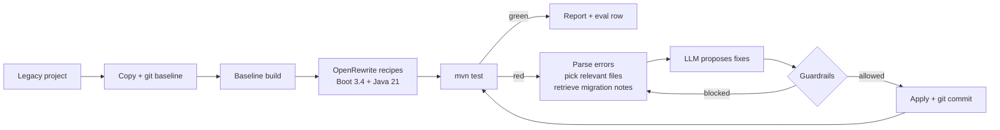

# MigrateMate

**An AI agent that upgrades legacy Java 8 / Spring Boot 2 applications to Java 21 / Spring Boot 3, and proves it with the project's own tests.**

Banks and enterprises still run hundreds of Spring Boot 2 services. Spring Boot 2.x is out of open-source support, so these upgrades are mandatory. Rule-based tools (OpenRewrite) handle most of the mechanical changes, but they always leave a tail of compile errors and failing tests that engineers fix by hand. MigrateMate runs the recipes first, then uses an LLM agent to fix whatever is left. It loops until `mvn test` is green, and guardrails make sure it can't "pass" by deleting tests.

Built with **Java 21, Spring Boot 3.5, Spring AI (ChatClient), Ollama (local LLM), OpenRewrite, Maven and Git**.

## How it works



1. **Safe copy.** The project is copied to `work/`, and the original is never touched. Every step is a git commit, so `git diff baseline` shows exactly what changed.
2. **Deterministic first.** OpenRewrite's `UpgradeSpringBoot_3_4` and `UpgradeToJava21` recipes do the mechanical work (javax → jakarta, versions, known API moves).
3. **Agent loop.** `BuildLogParser` turns the Maven log into structured failures (compile errors with `symbol`/`location` detail, failing tests). `FixPlanner` decides which files the model sees:
   - files with errors
   - types named in the error, e.g. the repository behind `cannot find symbol: save`
   - for web tests, the controller that matches the URL in the test
4. **Retrieval.** `MigrationNotes` is a small knowledge base of Boot 3 breaking changes. Only the notes whose keywords match the current errors go into the prompt.
5. **Guardrails** (`ChangeGuard`, addressing OWASP LLM06 *Excessive Agency*). A proposed change is rejected if it:
   - edits a file the agent wasn't shown, or escapes the project folder
   - removes `@Test` methods or assertions, or adds `@Disabled`
   - adds `skipTests` / `maven.test.skip` / `testFailureIgnore` to the pom
   - truncates a file or drops its class declaration
6. **Stop conditions.** The loop ends when:
   - all tests pass
   - it reaches the maximum number of iterations
   - the same errors come back after two fix attempts (no progress)
   - the model gives no usable answer twice in a row
7. **Transparency.** Every prompt and model answer is saved in `.migratemate/`, and `MIGRATION_REPORT.md` summarizes the run.

## Run it (Mac)

Prerequisites (one time):

```bash
brew install openjdk@21 maven git
ollama serve        # skip if the Ollama app is already running
```

Upgrade the bundled sample app:

```bash
./upgrade.sh
```

The first run builds MigrateMate and downloads the model (`qwen2.5-coder:7b`, about 4.7 GB) automatically.

Upgrade your own project:

```bash
./upgrade.sh /path/to/your/maven/project
```

### Modes

| Mode | What it does |
|---|---|
| `full` (default) | OpenRewrite recipes, then the AI fixes what's left |
| `recipes` | OpenRewrite only, no AI. This is the baseline for comparison |
| `ai` | Only bumps the versions in `pom.xml`; the AI does everything else |

```bash
./upgrade.sh samples/legacy-bank-app recipes
```

### Change the model

Edit `src/main/resources/application.yml` (`spring.ai.ollama.chat.options.model`), for example `qwen2.5-coder:14b` for better quality if you have the memory. Because the code only uses Spring AI's `ChatClient`, you can switch to OpenAI, Anthropic or AWS Bedrock by swapping the starter dependency and its properties.

## Evaluation

```bash
./eval.sh
```

This runs every project in `samples/` in all three modes and prints `eval/results.csv`: baseline, final result, test counts, AI iterations, files changed, guardrail blocks and time. It answers the question that matters: **how much does the AI add on top of the deterministic recipes?**

**Results** (MacBook Air M4, local `qwen2.5-coder:7b`, sample `legacy-bank-app`, 7 tests):

| Approach | Final build | Tests passing | AI iterations | Time |
|---|---|---|---|---|
| OpenRewrite only (`recipes`) | FAIL | 6 / 7 | 0 | 20 s |
| Version bump + AI only (`ai`) | FAIL (never compiled) | 0 / 7 | 6 (max) | 251 s |
| **OpenRewrite + AI (`full`)** | **PASS** | **7 / 7** | 2 | 80 s |

What this shows:
- **Neither approach is enough alone.** The recipes fixed every compile error but missed a runtime behaviour change (Spring 6 trailing-slash matching, which caused a 404). A small local model alone could not finish the whole migration in 6 attempts. Together they reach a green build.
- **Self-correction works.** In iteration 1 the model fixed the URL mapping but dropped an import. The compile error was fed back, and iteration 2 restored it.
- **Prompt design mattered.** In the first version, the failing test file was editable. The model returned it unchanged twice, and the run failed. After making tests read-only context, retrieving notes from the error text only, and feeding back why an answer was rejected, the same model passed.

### The sample: `samples/legacy-bank-app`

A small Java 8 / Spring Boot 2.7 account service (JPA, validation, REST, RestTemplate) with 7 tests. It deliberately includes real Boot 3 breaking changes:

| Breaking change in Boot 3 / Spring 6 | Where |
|---|---|
| `javax.*` → `jakarta.*` | `Account`, `AccountController` |
| `PagingAndSortingRepository` no longer extends `CrudRepository` | `AccountRepository` (breaks `save` / `findById`) |
| `getStatusCode()` returns `HttpStatusCode`, not `HttpStatus` | `FxRateClient` |
| `ResponseEntityExceptionHandler` signatures changed | `ApiExceptionHandler` |
| Trailing-slash URL matching removed (runtime 404, not a compile error) | `AccountControllerTest.legacyClientsUseTrailingSlash` |

## Project layout

```
src/main/java/io/github/mahipvk/migratemate/
  MigrateMateApplication.java   CLI entry point
  UpgradeAgent.java             the agent loop
  AiFixer.java                  Spring AI ChatClient + prompt building
  core/
    BuildLogParser.java         Maven log -> structured failures
    FixPlanner.java             which files the model sees
    ChangeGuard.java            guardrails
    MigrationNotes.java         keyword retrieval over the notes
    FileBlocks.java             model input/output format
    PomBumper.java              version bump for "ai" mode
    Shell.java, ReportWriter.java
src/main/resources/prompts/     system prompt + migration notes
samples/legacy-bank-app/        demo / eval project
```

## Known limitations

- Maven only (no Gradle yet).
- Small local models sometimes return incomplete files. The guardrails catch this, but a run can still stop early. A larger model or a hosted one improves the success rate.
- The eval set is small. Adding more sample projects is the next step.
